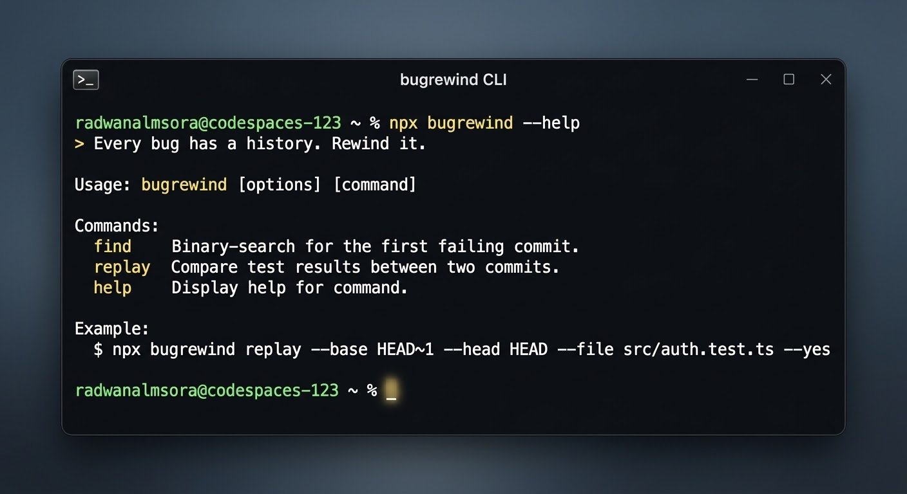

<p align="center">
  
</p>

# BugRewind
[](https://developer.mozilla.org/en-US/docs/Web/JavaScript)
[](https://www.typescriptlang.org/)
[](https://nodejs.org/)
[](https://vitest.dev/)
[](https://git-scm.com/)


[](https://github.com/radwanalmsora/bugrewind/actions/workflows/ci.yml)

[](https://www.npmjs.com/package/bugrewind)
[](https://opensource.org/licenses/MIT)
[](https://nodejs.org)

> Every bug has a history. Rewind it.

BugRewind investigates **why a test started failing between two commits**, using real test execution
instead of guesses.

**Status: early development (v0.2).** `bugrewind replay` and `bugrewind find` are implemented.
Everything else in the roadmap below is *not* implemented yet.

## What works today

`bugrewind replay` runs the same [vitest](https://vitest.dev) selection on a baseline commit and a
head commit, each in its own temporary `git worktree`, and compares the results:

| Baseline | Head | Verdict |
|----------|------|---------|
| pass | fail | `regression-reproduced` |
| pass | pass | `not-reproduced` |
| fail | fail | `already-failing` |
| fail | pass | `fixed-in-head` |
| anything else (no tests found, crash, timeout) | | `inconclusive` |

It never reports a pass it did not observe. `regression-reproduced` means the behavior differs
between the two commits; it does **not** say which change caused it.

### `bugrewind find`

Given a commit where the tests pass (`--good`) and one where they fail (`--bad`, default `HEAD`),
`find` binary-searches the history in between and reports the **first commit where the tests fail**,
with its author, message, and the files that changed since its predecessor. It needs only
about log2(N) test runs for N commits.

```bash
npm run dev -- find --good v1.2.0 --bad main --file src/auth/session.test.ts --yes
```

The result is only reported as `culprit-found` when the culprit's predecessor was actually run and
passed, and the culprit was actually run and failed. If a commit in the way cannot be tested (crash,
no tests, timeout), the verdict is `inconclusive` with the remaining range. It follows first-parent
history, assumes the failure appeared once and stayed, and can be misled by flaky tests.

## Requirements

- Node.js 20 or newer (Linux or macOS; Windows is not supported yet)
- git
- A project that uses vitest, with dependencies installed (`node_modules` is linked into the worktrees)

## Develop

```bash
npm install
npm test
npm run typecheck
```

## Usage

```bash
npm run dev -- replay --base HEAD~1 --head HEAD --file src/auth/session.test.ts --yes
npm run dev -- replay --base v1.2.0 --head main --test "refreshSession" --json --yes
```

| Option | Meaning |
|--------|---------|
| `--base <ref>` | baseline commit or ref (default `HEAD~1`) |
| `--head <ref>` | head commit or ref (default `HEAD`) |
| `--file <path>` | test file to run |
| `--test <pattern>` | test name pattern (vitest `-t`) |
| `--timeout <s>` | timeout per run (default 120) |
| `--node-modules <path>` | node_modules to link into the worktrees |
| `--json` | machine-readable output |
| `--yes` | required: confirms test code from both commits may run on this machine |

Exit codes (both commands): `0` no regression observed (or fixed), `1` regression reproduced / culprit found,
`2` usage or runtime error, `3` inconclusive or already failing.

## Safety

- Your working tree, index, and uncommitted changes are never modified.
- Test code is executed only with `--yes`. Test code can run arbitrary commands: use it on code you trust.
- Variables whose names look like secrets (`*API_KEY*`, `*TOKEN*`, `*SECRET*`, `*PASSWORD*`) are not passed to the test process.
- Nothing is sent over the network. There is no AI component in this version.

## Limitations

- vitest only.
- `node_modules` is shared from your project; dependency differences between commits are not reproduced.
- Environment variables, services, and data that tests need are not recreated.
- Uncommitted changes are not included in either run.


## 🔍 How it Works

1. **Isolation:** Creates temporary, isolated `git worktrees` for the baseline and head commits.
2. **Execution:** Runs your [Vitest](https://vitest.dev) suite independently in both environments.
3. **Comparison:** Analyzes outcomes and delivers a clear verdict (`regression-reproduced`, `culprit-found`, etc.) without touching your current working directory.

## Roadmap (not implemented)

Evidence engine and reports, AST-based impact analysis, optional AI analysis (OpenAI/Gemini),
MCP server, regression-test generation.

## Contributing and security

See [CONTRIBUTING.md](CONTRIBUTING.md) and [SECURITY.md](SECURITY.md). Changes are listed in [CHANGELOG.md](CHANGELOG.md).

## License

MIT

## 🚀 Quick Start (No Installation Required)

You can run BugRewind instantly using `npx`:

```bash
npx bugrewind replay --base HEAD~1 --head HEAD --file src/my.test.ts --yes
